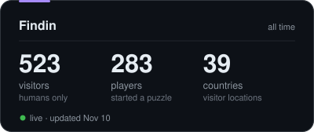
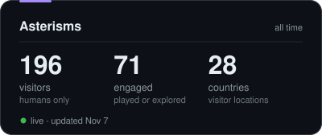
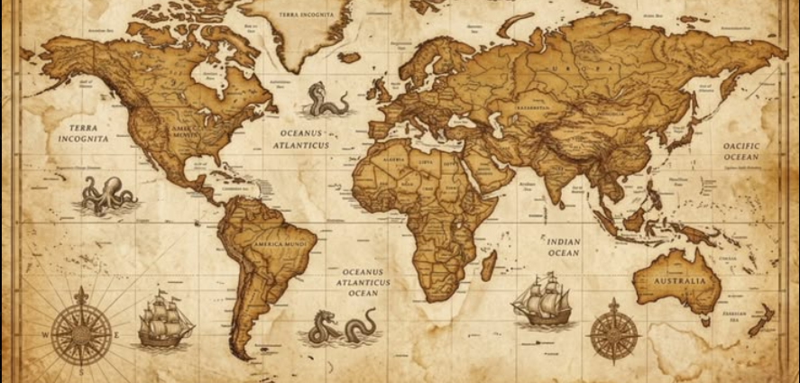
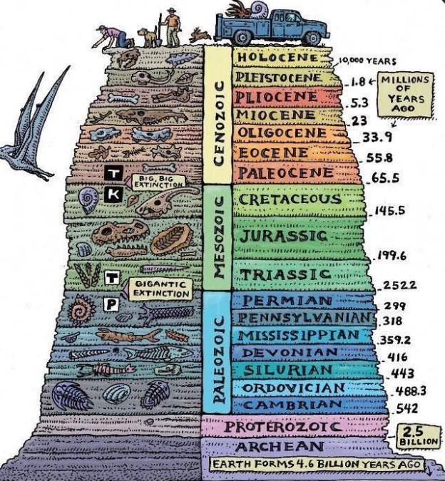
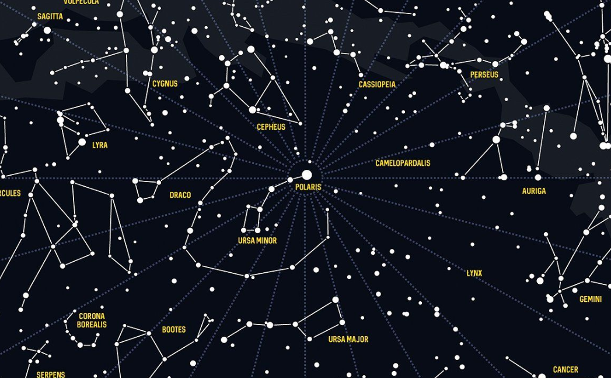
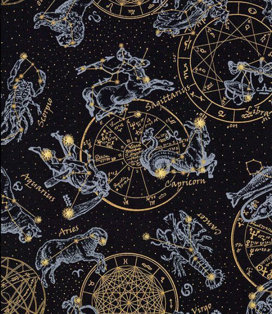
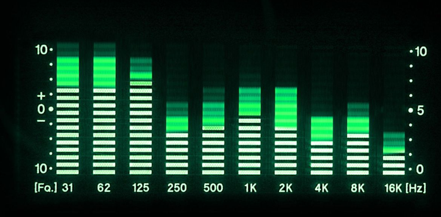
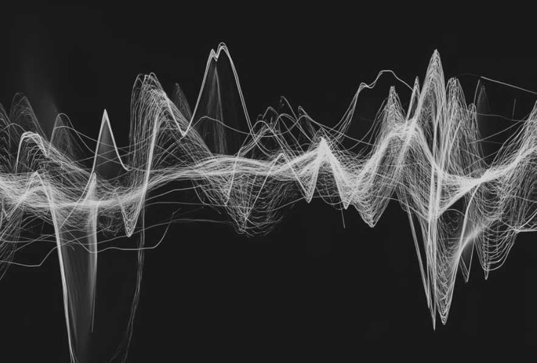

### Founding Engineer / Full-Stack Engineer · Bengaluru, India

---

## about me

I build products end to end: from ambiguous requirements and UX through frontend, backend, AI workflows, auth/security, billing, observability, and production deployment. Most projects here start the same way: a question I couldn't leave alone that turned into something real enough to run, break, and keep pushing on.

- 🎓 B.Tech CS, Dayananda Sagar University, Class of 2026 · Network School, Singapore & Malaysia
- 📎 Every number on my [portfolio](https://mukndd.com) ships with a source and a verified flag: nothing renders without both. Same standard applies here

---

## who's using it

<!-- STATS:START -->

  
  

Real people, not repo stats: unique human visitors and players on the production sites, counted in PostHog with bots and my own test accounts excluded. A GitHub Action refreshes them when it can reach PostHog; otherwise a card shows a dated snapshot. Details: <a href="stats/data.json">stats/data.json</a>.

<!-- STATS:END -->

---

## selected projects

**[Portfolio](https://mukndd.com)**: Explore my work through Calia, a walkable pixel-art island, or go straight to the resume. Built for wandering or a quick skim. [Visit mukndd.com](https://mukndd.com)

**🎨 [Chromelo](https://chromelo.art)**: Turn a song, voice note or recording into artwork shaped by its sound. Stack visual effects and explore how different recordings look. Audio stays on your device. `Next.js` · [Visit chromelo.art](https://chromelo.art)

**🌍 [Findin](https://findin.world)**: A browser game combining geography with deep time: read the evidence, guess **where** an animal lived and **when**, with real paleogeographic coastlines for extinct species instead of pretending ancient life belongs on today's map. Built the full content pipeline (GBIF, Paleobiology Database, GPlates-derived reconstructions) with quality gates and a manually verified launch set of species. `Next.js` `TypeScript` `Supabase` `PostHog` · [case study](https://github.com/mukndd/findin-case-study)

  
  

**✨ [Asterisms](https://asterisms.space)**: A constellation-learning game that grew into a real-sky explorer. Daily and Practice puzzles run on a *real* astronomy catalogue (88 IAU constellations, 74 Western asterisms), projected with real gnomonic RA/Dec math, not decorative particle stars. The same engine now drives Tonight (location-aware stargazing), Seek (any sky from 1900 to now) and Guided Find. Neon Postgres handles only puzzle scheduling and leaderboards, so a DB outage degrades the leaderboard, never the game. Sole builder: data pipeline, gameplay, sky engine, frontend. `Next.js` `Neon` `Drizzle` `PostHog` · [case study](https://github.com/mukndd/asterisms-case-study)

  
  

## more builds

**✋ [Gesture-Based System Equalizer](https://github.com/mukndd/gesture-based-eq)**: a webcam, your hand, and a 10-band system-wide audio EQ: no mouse, no sliders. Finger-count selects the band, a pinch adjusts it with exponential smoothing to kill jitter, an L-shape gesture locks it, and a two-hand gesture resets.
`Python` `OpenCV` `MediaPipe` `PyQt5`

  
  

More (CareerBridge, hardware builds) on the [portfolio](https://mukndd.com), where every claim is checked against source.

---

## core stack

Full breakdown per project on the [portfolio](https://mukndd.com).

---

